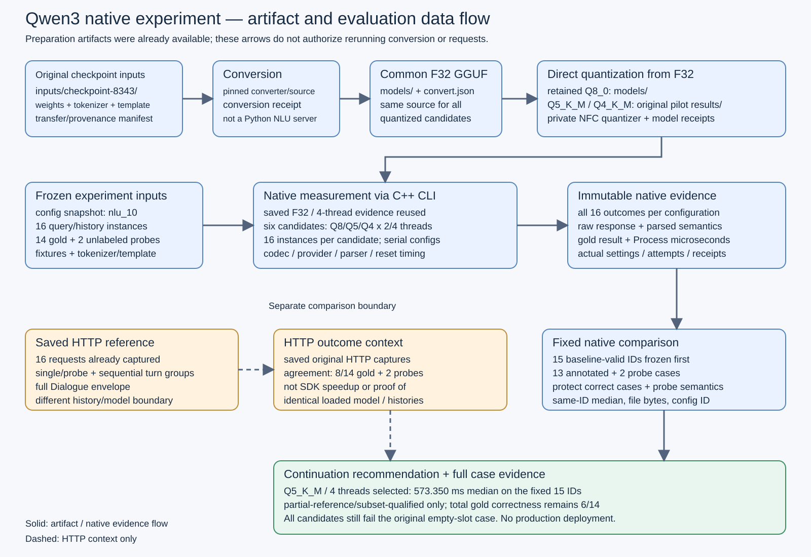
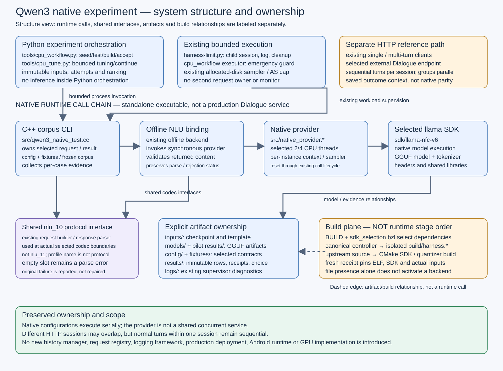

# Qwen3 Native Experiment — Directory and Workflow Guide

Updated: **18 November 2026**. This guide explains the folders in the existing experiment, how they fit together, and where to look for source, models, build outputs and results.

## 1. Scope and evidence

**Authoritative experiment root:**

```text
/home/daigd/dialogue/experiments/qwen3_native
```

This is the Ubuntu source/build workspace, not a workstation mirror, a deployed Dialogue service or an Android package. The authoritative inventory was captured **2026-11-18 06:25–06:28 UTC**, at parent revision `ac8b0420d82b5f3b60c536a9e63b5f74429ee0ab`. Generated/ignored experiment files also require their actual receipts; the parent revision alone does not identify their bytes.

- **CODE-CONFIRMED:** purpose established by source/configuration consumers and producers.
- **BUILD-CONFIRMED:** selected build/SDK/workspace relationship established by a build receipt.
- **RUNTIME-CONFIRMED:** outcomes established by the completed bounded experiment.
- **PARTIAL:** sampled contents are known, but the individual historical producer or current use was not fully reconstructed.

All **12 top-level folders** and their second-level directory names were inventoried. Deeper inspection was bounded and selective. Counts below are a snapshot, not permanent limits. No cleanup, builds or inference were performed for the inventory. No root README was present, so purposes were checked against BUILD, source, configuration and receipts instead of inferred from names alone.

Related documents:

- [Deployment and experiment walkthrough](qwen3-native-cpp-deployment-guide.html)
- [Measured auto-tuning continuation](qwen3-native-cpp-deployment-guide.html#cpu-continuation)
- [Detailed native integration background](qwen3-checkpoint-8343-native-integration-report.md)
- [Continuation execution check](../check/PLAN-20261118-qwen3-candidate-continuation-CHECK.md)

## 2. The directory in one picture

```text
qwen3_native/
├── src/               Authored C++ provider, CLI and native tests
├── fixtures/          Test cases, tokenizer goldens and mocked/oracle data
├── config/            Experiment selector/profile/protocol snapshot
├── tools/             Python/Bash orchestration and focused tests
├── inputs/            Original checkpoint, tokenizer and template inputs
├── archives/          Retained downloaded dependency/tool archives
├── third_party_src/   Extracted baseline and NFC-v6 llama source
├── sdk/               Installed SDKs and private Python/build prerequisites
├── models/            Converted F32 and baseline Q8_0 GGUF models
├── build/             Generated CMake/Bazel work, staging and before-images
├── results/           Receipts, seeds, outputs, comparisons and recommendations
└── logs/              Stage/supervisor logs and historical evidence
```

Important root **files**, not additional folders:

- `BUILD`: Bazel targets and dependency selection. It is not a runtime execution-order diagram.
- `sdk_selection.bzl`: baseline versus explicitly selected NFC-v6 SDK choice.
- `.gitignore`: explains why generated or experiment artifacts may not appear in ordinary tracked Git status. Absence from status does not prove absence from disk or disposability.

### How the folders work together

```text
archives/ ── extract/build ──> third_party_src/ ── compile/install ──> sdk/
                                      │                               │
inputs/checkpoint-8343/ ── conversion ──┘                               │
           │                                                          │
           └──> models/F32.gguf ── direct quantization ──> Q8/Q5/Q4      │
                                                                      │
src/ + BUILD + selected SDK ── isolated build/ workspace ──> native CLI ┘
config/ + fixtures/ or a frozen corpus + model ──> native CLI
                                                      │
                                             results/ + logs/
```

This is a simplified **artifact workflow**, not the production Dialogue pipeline. Python orchestrates; the native C++ provider performs model inference. Q5/Q4 from the latest pilot are stored under that pilot's `results/` directory, **not** under `models/`.

### Visual maps (SVG, open directly or zoom in)



[Open the data-flow SVG](qwen3-native-experiment-dataflow.svg). Solid arrows show artifact/native evidence flow. Dashed HTTP context is not proof of identical model/history or a native speedup. The original failure remains in all16 candidate inputs.



[Open the system-structure SVG](qwen3-native-experiment-structure.svg). Runtime calls, shared protocol interfaces, artifacts and build relationships are distinguished. This is not the production EU/NLU/DM pipeline or an Android/GPU design.

## 3. Start here: authored code and test contracts

### `src/` — the C++ implementation

The inventory contains five files:

| File | Role |
| --- | --- |
| `native_provider.h` / `native_provider.cc` | Native provider boundary connecting the experiment to existing offline-inference interfaces and the selected llama SDK |
| `qwen3_native_test.cc` | Standalone CLI: constructs selected NLU requests, invokes the backend/provider and records parser/provider/result evidence; includes corpus mode |
| `provider_test.cc` | Focused provider/offline-binding tests, including mocked fixture consumption |
| `nfc_tokenizer_test.cc` | NFC/tokenizer validation target |

Read the entrypoint together with the real protocol and offline-backend interfaces it calls; do not treat this as a separate production NLU protocol. The selected experiment uses **`nlu_10`**.

Source anchors: `BUILD:55–112`, `src/native_provider.h:1–11`, `src/qwen3_native_test.cc:25–26,327–333,376`.

### `fixtures/` — expected behavior, not model weights

Ten files were present. Their roles differ:

- `mock-responses.json`: mocked backend responses for tests; not captured live model performance.
- `semantic-smoke.json`, `semantic-smoke-unknown-v7.json`: semantic acceptance cases, including expected unknown/rejection behavior.
- `tokenizer-goldens.json`, `tokenizer-normalization-probe.json`: tokenizer reference fixtures.
- `service-default-tokenizer-goldens.json`, `service-default-tokenizer-normalization-probe.json`: selected service-default tokenizer/normalization references used by the current native path.
- `nfc-v6-baseline-controls.json`, `nfc-v6-unicode-oracle.json`: NFC controls and Unicode oracle data.
- `existing-fixture-provenance.json`: provenance for inherited fixture data.

A golden/oracle asserts a specific contract. It is not interchangeable with a user query, a generated model answer, or an annotated evaluation corpus. Do not rewrite expected results merely to make a failing model pass.

Source anchors: `BUILD:85–89,104–108`; `src/provider_test.cc:21,66,368–371`.

### `config/` — experiment selection, not live deployment

```text
config/
├── selector.json
├── provenance.json
└── conf/models/nlu/
    ├── profiles.json
    └── protocols/v3.json
```

The loader follows **selector → selected profile → protocol descriptor**. The profile is named `nlu_06b_v3`, but the inspected descriptor identifies **`nlu_10`**. A profile name or `v3.json` filename is not evidence that the experiment uses `nlu_11`.

`provenance.json` describes a historical deployment-origin projection. It does **not** prove that the current deployed service has the same loaded model, configuration or history behavior. The tuner uses an isolated copy of the selected chain in its run directory, changing only the approved multi-intent policy; original configuration is preserved.

Source anchors: `config/selector.json:2–3`, `config/conf/models/nlu/profiles.json:3–5`, `config/conf/models/nlu/protocols/v3.json:23`, `config/provenance.json:45–46`.

### `tools/` — the control panel

Thirteen authored files and generated `__pycache__/` were present:

| Tool | What to use it for |
| --- | --- |
| `run.sh` | Existing stage entrypoint; inspect its supported actions rather than assuming it runs every stage |
| `native-stage.py` | SDK/conversion/quantization stages and their receipts; supports the selected private NFC quantizer path |
| `cpu_workflow.py` | Reproducible CPU seed/test/build/accept workflow and provenance |
| `cpu_tune.py` | Bounded tuning preparation, build, quantization, HTTP collection, native evaluation, selection and additive partial-reference continuation |
| `harness.sh` | Isolated experiment build/test orchestration, selected SDK/mode and work-directory setup |
| `harness-bazel.sh` | Bazel invocation inside that work environment |
| `harness-limit.py` | Existing bounded workload supervisor, logging and cleanup owner |
| `service_default_reference_v5.py` | Offline service-default reference generation using retained reference assets |
| `reproduce_hf_states_v5.py` | Historical HF argument/state reproduction tooling |
| `compare_hf_native_v6.py` | Historical HF/native comparison tooling |
| `test_cpu_workflow.py`, `test_cpu_tune.py`, `test_native_stage.py` | Focused tests for the corresponding orchestration contracts |
| `__pycache__/` | Generated Python bytecode, not authored implementation or a model |

The fixed CPU acceptance and the tuner are different workloads: the older acceptance has fixed/ABA/warm checks; the tuning corpus runs must not silently replay those generations. Help/dry-run are the safe introduction; a real build or inference operation is a separate action.

Source anchors: `tools/run.sh:5–13`, `tools/harness.sh:29–44,82–99`, `tools/cpu_workflow.py:366–378`; the implemented CLI parsers own exact current flags. Historical `v5`/`v6` tool names are not proof of current activation.

## 4. Model inputs, archives and source dependencies

### `inputs/checkpoint-8343/` — original conversion inputs

Eleven files were observed:

- Weights: `model.safetensors`.
- Model/generation definitions: `config.json`, `generation_config.json`.
- Tokenizer bundle: `tokenizer.json`, `tokenizer_config.json`, `special_tokens_map.json`, `added_tokens.json`, `merges.txt`, `vocab.json`.
- Prompt rendering: `chat_template.jinja`.
- Transfer/provenance: `transfer-manifest.json`.

These files belong together. GGUF conversion is not just renaming the weights; tokenizer/template and selected conversion implementation matter. This folder is the **input checkpoint**, not a generated quantization output directory or an inference endpoint.

Source anchors: `tools/native-stage.py:87–95,331–332`.

### `archives/` — downloaded material retained for reproduction

The second-level directories are:

```text
cmake-3.31.6/
cpython-3.11.14-20251014/
llama-3bb63cbcbfb62056c84fe9e521b0f3d756d29c32/
micromamba-2.3.2-0/
revision-3bb63cbcbfb62056c84fe9e521b0f3d756d29c32/
```

Sampled contents include `cmake.whl`, `cpython.tar.gz`, `llama.cpp.tar.gz`, `micromamba.tar.bz2` and `commit.json`. These are acquisition/recovery artifacts, not installed libraries. Individual archive continued use is **PARTIAL**: existence does not show that every current operation still reads it.

Keep downloaded/extracted material separate from authored scripts. Do not execute everything in an archive directory to discover what it does. Python inspection of untrusted acquired data should use isolated mode (`-I`). The current task did not download, install or rebuild these prerequisites.

Source anchors: `tools/native-stage.py:129–143` and sampled inventory.

### `third_party_src/` — dependency source, not installed SDK

```text
third_party_src/
├── llama-3bb63cbcbfb62056c84fe9e521b0f3d756d29c32/
└── llama-3bb63cb-nfc-v6/
```

The full-revision directory is the pinned baseline source family; the separate NFC-v6 directory is the candidate source family used for the selected NFC SDK/private quantizer. These contain upstream source and conversion code. They are not the installed `include/`/`lib/` closure consumed by native targets.

Keep baseline and candidate identity distinct: a matching upstream revision does not erase a local NFC patch or prove identical built libraries. Product-wide third-party dependencies outside this experiment are a separate repository boundary.

Source anchors: `tools/native-stage.py:87,140–143`; selected candidate build receipt.

## 5. `sdk/` — installed libraries and private prerequisites

```text
sdk/
├── llama/          Baseline installed SDK
├── llama-nfc-v6/   Explicitly selectable NFC-v6 installed SDK
└── prerequisites/  Private build/conversion/reference dependencies
```

Both SDK installations contain `include/` and `lib/` with llama/ggml headers and the `libllama`, `libggml`, `libggml-base`, `libggml-cpu` shared-library families. Deeper library symlink targets were recorded without following them.

**CODE-CONFIRMED:** baseline is the default in `sdk_selection.bzl`; NFC-v6 needs explicit selection. The completed tuning receipts prove the NFC-v6 selection for that experiment. Merely having both folders does not activate both backends. Ubuntu shared libraries do not establish CentOS or Android ABI compatibility.

### The eight `sdk/prerequisites/` families

| Directory | Meaning / observed contents | Confidence boundary |
| --- | --- | --- |
| `cmake-3.31.6/` | Private CMake distribution; `cmake/` and package metadata | Explicit stage consumer confirmed |
| `conda-convert/` | Private conversion Python environment; `bin/`, `lib/`, `include/`, `conda-meta/` and related runtime directories | Current experiment interpreter is here; Python inference serving is not implied |
| `conda-channel/` | Retained `linux-64/` and `noarch/` package-channel layout | Layout observed; individual package current use not exhaustively traced |
| `conda-state/` | Package-manager `cache/`, `home/`, `pkgs/`, `tmp/` state | State, not authored source or a model |
| `converter-artifacts-20261023a/` | 88 retained extracted/package entries for converter prerequisites | Entries grouped rather than all listed; not proof these versions are product dependencies |
| `cpython-3.11.14/` | Retained private Python installation under `python/` | Does not mean it is the interpreter selected by every current tool |
| `micromamba-2.3.2/` | Private package-manager executable family under `bin/` | Presence does not authorize package installation |
| `service-default-v5/` | Offline reference bundle: `protocol-inputs/`, `runtime/`, `snapshot/`, `wheels/`, `wheel-manifest.json` | Reference tool consumes its snapshot; this is not a live service |

Do not confuse the Python prerequisites with the native compiler/SDK. The product baseline remains GCC/G++4.9.3 and C++11; the standalone experiment's established GCC8/native and C++17 quantizer exception does not upgrade the product toolchain. Package filenames mentioning a newer compiler also do not establish the compiler actually used.

Source anchors: `sdk_selection.bzl:1–10`, `BUILD:12–53`, `tools/native-stage.py:89–93,262`; selected nested inventory and reference-tool consumers.

## 6. `models/` — stable converted baseline artifacts

Two files were present:

| File | Role | File bytes |
| --- | --- | ---: |
| `nlu-v12modi-8343-F32.gguf` | Common converted reference; source of direct quantization | 2,390,151,008 |
| `nlu-v12modi-8343-Q8_0.gguf` | Retained Q8 baseline | 639,446,880 |

`results/convert.json` and `results/quantize.json` retain the corresponding conversion/quantization evidence. The new Q5/Q4 outputs are instead:

```text
results/nlu10-pilot-20261118T042729114655Z/Q5_K_M.gguf
results/nlu10-pilot-20261118T042729114655Z/Q4_K_M.gguf
```

Their respective sizes are444,414,816 and396,704,608bytes. They were generated separately, directly from the same F32—not by quantizing Q8 again. **All listed sizes are model-file bytes, not peak RSS or a device memory requirement.**

## 7. `build/` — generated work, but not automatically disposable

Snapshot: **55 directories, including43 `harness.*` workspaces**. Multiple workspaces are expected: build/test isolation, SDK experiments, failed attempts and controls preserve their own work/evidence. Many folders do not mean many active servers.

### Important families

| Family | Purpose / observed contents |
| --- | --- |
| `llama-sdk/` | Generated baseline SDK CMake build; cache, generated makefiles, compile commands, source build subdirectories and install manifest |
| `llama-quantize/` | Generated quantizer build family |
| `sdk-nfc-v6/` | Generated NFC candidate SDK CMake build family |
| `harness.*` | Isolated Bazel/native/control workspaces; exact roles differ by receipt and command |
| `host-integration-*`, `final-integration-*` | Scoped integration staging and `before/` recovery copies |
| `http-client-validation-*` | Staged existing HTTP clients and validation inputs/tests; not an HTTP server |
| `tune-inputs-*` | Selected corpus excerpts plus source provenance, not a full new dataset |
| `tuner-host-*` | Host-side tuner validation staging family |
| `phase3-apply.*`, `phase3-validation.*` | Retained application/validation staging, patches or metadata |
| `bazel-help/` | Retained Bazel help/inspection material |

The exact non-harness names are listed in the appendix. Roles of individual historical staging directories are **PARTIAL** where only contents were sampled; not every original producer was reconstructed.

### Inside an isolated harness workspace

The harness and actual build commands use per-work directories for compiler wrappers, `home/`, `tmp/`, sandbox, Bazel install/output/user-root and repository/disk caches. The native ELF can be inside the Bazel output tree, for example:

```text
build/harness.<id>/output/execroot/dialog/bazel-out/k8-opt/bin/
  experiments/qwen3_native/qwen3_native_test
```

Read the receipt's actual `work` and binary path, not this template or whichever directory sorts last. Some `harness.*` folders are controls/SDK work rather than an optimized CLI build.

**BUILD-CONFIRMED current references:**

- Latest continuation build receipt → `build/harness.xgryZf`.
- Original pilot build receipt → `build/harness.28pNZC`.
- Candidate SDK receipt references `build/harness.nfc-v6-binding.2bPe7CIq`.

Deleting one of these workspaces can break a retained receipt even when the final GGUF model still exists. A successful later build does not automatically make earlier failure evidence or rollback copies disposable.

Source anchors: `tools/harness.sh:82–99`, current build/SDK receipts; the actual command records establish selected flags and output paths.

## 8. `results/` — receipts, evidence and recommendations

Snapshot: **28 directories and five root-level files**. Unlike `build/`, this is where you normally start when asking “what happened?” However, results often reference binaries still located in `build/`.

### Root-level files

| File | Meaning |
| --- | --- |
| `acquisition-manifest.json` | Acquired input/dependency provenance |
| `build-sdk.json` | Baseline SDK build evidence |
| `convert.json` | F32 conversion receipt |
| `quantize.json` | Baseline Q8 quantization receipt |
| `v5-hf-argument-states.json` | Historical HF argument/state evidence |

### Result families

| Prefix/family | How to interpret it |
| --- | --- |
| `cpu-seed-*` | Sealed dependency seed/provenance; reusable build input, not a model or inference result |
| `cpu-*-test`, `cpu-*-build`, `cpu-*-accept` | Separate CPU test/build/accept operations and their summaries/receipts |
| `nfc-v6-preparation`, `nfc-v6-build` | NFC candidate preparation/build evidence; includes selected SDK receipt |
| `nfc-v6-*comparison*`, `nfc-v6-*reference*`, `nfc-v6-*acceptance*` | Historical comparisons, reference generation and acceptance, not interchangeable runs |
| `nfc-v6-observation-preimages-*` | Retained before-images for scoped instrumentation corrections |
| `nfc-v7-acceptance-*` | Historical v7 acceptance; does not replace newer receipts or make every old result current |
| `v5-*` | Historical service-default references, rendering/argument audits and boundary captures |
| `nlu10-pilot-*` | Frozen corpus/configuration, model artifacts, HTTP/native results and original tuning recommendations |
| `*-continuation` | Separate immutable candidate continuation; references saved F32/HTTP evidence rather than rewriting it |
| `nlu10-continuation-build-*` | Fresh build-only provenance for continuation code |
| `native-reference-*`, `phase2b-python-provenance-*`, `phase3-sandbox-backup.*` | Retained reference/provenance/recovery families; individual contents vary |

Names are navigation hints, not a state machine. Always inspect the actual summary/receipt and parent references before classifying a run as successful, failed, superseded or still needed.

### The three directories to open for the latest tuning result

Let `R` mean the authoritative root above.

| Path under `R/results/` | Why it matters |
| --- | --- |
| `nlu10-pilot-20261118T042729114655Z/` | Original16-case corpus/config, saved F32/HTTP outputs, Q5/Q4 models, original build and model receipts; original recommendation remains `invalid-reference` |
| `nlu10-pilot-20261118T042729114655Z-continuation/` | Six measured candidates, fixed15 comparison subset, all16 outcomes, recommendation and cumulative call ledger |
| `nlu10-continuation-build-20261118T061653739701Z/` | Fresh optimized build receipt selecting `build/harness.xgryZf`; a build-only directory, not another inference run |

The continuation selected **Q5_K_M at four threads**, status **`partial-reference/subset-qualified`**. The same15-case median was573.350ms versus saved F32's1322.931ms. Correctness remained6/14 total annotated cases; every candidate retained the original empty-slot failure. This is not full16-case qualification, broad accuracy, production readiness or HTTP/native parity.

Q4 scored7/14 but failed exact probe semantics and introduced a new business rejection. Aggregate correctness alone did not override those regression gates. See the [measured table](qwen3-native-cpp-deployment-guide.html#cpu-continuation).

### Which file answers which question?

| Question | Read |
| --- | --- |
| What was selected, and why were others rejected? | Continuation `recommendation.json` |
| Exactly which queries, gold labels, histories and comparison IDs were used? | Original/continuation `inputs.json`; original `corpus.json` |
| Was a result generated or just skipped? | `*-assessment.json`, actual `*-native.json`, reservations and command records together |
| What did the native model actually emit and how did parsing finish? | Per-case rows in `*-native.json` |
| What did HTTP return? | Original `*-http.jsonl` captures, their attempt/exit records and comparison report |
| How many calls were reserved/completed? | Recommendation attempt ledger plus `*-attempt.json` and complete native accounting |
| Which ELF and SDK were used? | `native-build/build-receipt.json`, its binary/work/candidate records |
| Where did Q5/Q4 come from? | Original `Q5_K_M-quantize.json`, `Q4_K_M-quantize.json`, private quantizer receipt and common F32 lineage |
| Why did the first tuning stop? | Original `measured-report.json` / `recommendation.json` and F32 native row; do not confuse these with continuation selection |

## 9. `logs/` — diagnose without discarding provenance

Snapshot: **24 directories and77 files**, including65 `harness-*.log` files. The inventory inspected names/counts and receipt references, **not the log bodies**. Existing completed execution evidence establishes the specific log outcomes cited in the walkthrough.

Stage/supervisor logs record commands, initialization, resource policy, diagnostic failures and terminal status. Historical subdirectories also retain diagnostic/provenance material; not every directory is an active logger or an equivalent run.

Examples tied to the current receipt chain:

- Fresh continuation build: `logs/harness-9arydgd6.log`.
- Original F32 run: `logs/harness-5ieuhnu1.log`.
- Six continuation native owner logs: `harness-ls74x_4m.log`, `harness-fwpsankb.log`, `harness-2lnow9rt.log`, `harness-o6k2xvxs.log`, `harness-dcrc4xzf.log`, `harness-f3r7bkbu.log`.

A native exit4 can mean the documented parse/acceptance failure despite complete generation; it is not automatically a crash or timeout. Conversely, an outer CLI exit0 is not a gold-correctness assertion. Read the owned terminal status and structured rows together.

## 10. What to preserve, and what this guide does not authorize

**No directory in this inventory has been classified safe to delete.** Generated status, age, a successful later build, or an ignored Git path is not sufficient evidence of obsolescence.

Preserve the connected chain:

```text
checkpoint/tokenizer/template + conversion source/receipt
  → F32 identity → quantized-model identities/receipts
  → selected SDK headers/libraries/source/patch identity
  → actual ELF + build workspace + build receipt + repository seed
  → frozen config/corpus/history + commands/reservations
  → native/HTTP rows + assessments/recommendation + logs
```

Important cautions:

1. **Build workspaces may still contain the only ELF referenced by a receipt.** Keeping JSON while deleting its binary breaks reproducibility.
2. **Seeds are inputs too.** Both current build receipts reference `results/cpu-seed-20261117T025245Z-980a5cc0/repository-seed.json`.
3. **Do not overwrite an old run to make it look successful.** The original invalid-reference recommendation and the later subset-qualified result answer different questions.
4. **Before-images are recovery evidence, not duplicate garbage.** Integration `before/` trees and owner-cache backups preserve scoped previous contents. Outside-root owner-cache locations were referenced by existing records, but were not inspected for this folder inventory.
5. **No automatic rebuild/download/restart follows from this document.** Diagram arrows explain relationships, not permission to execute them.
6. **Runtime limits are not measured capacity.** The completed continuation's sampled allocation was4,199,317,504bytes, plus536,870,912 reserved log bytes, below8GiB; per-process address-space bounds are not aggregate/peak RSS. These figures cover the attributed task, not the entire experiment tree's disk size.
7. **Production/platform boundaries remain unverified.** No folder's presence proves production activation, Android-device support, GPU execution or CentOS ABI compatibility.
8. **Symlink evidence is depth-limited.** No links were observed at inventory depths1–2; deeper sampled SDK links were recorded without following them. This is not a whole-tree no-symlink claim.

Any later cleanup should be a separate, explicitly scoped operation that checks references and recovery requirements first. This document intentionally supplies no broad deletion commands.

## 11. A practical reading order

### To understand the code

1. `src/qwen3_native_test.cc`: request/response path and CLI modes.
2. `src/native_provider.h` / `.cc`: provider ownership, selected SDK and per-call behavior.
3. `config/selector.json` and its selected references: exact protocol/settings.
4. `fixtures/`: expected tokenization/parser/unknown contracts.
5. `tools/cpu_tune.py`, then `cpu_workflow.py` and harness scripts: orchestration, measurement and provenance.

### To understand the latest experiment

1. Continuation `recommendation.json`: selection, qualification and exclusions.
2. Continuation `inputs.json`: frozen15 comparison IDs and original16 cases.
3. One candidate's native result and assessment: raw output versus parser outcome versus gold correctness.
4. Original `measured-report.json` and HTTP captures: saved reference and boundary differences.
5. Fresh build receipt → referenced harness work/ELF → selected SDK receipt.

### To understand why there are so many folders

Read the build/result family tables before opening individual old directories. Multiple names mostly represent isolated operations, historical versions, failed attempts, reference states and recovery boundaries—not an obligation to rerun everything.

## 12. Evidence index and limitations

Source citations are relative to the authoritative experiment root, at the inspected revision plus relevant retained working-tree artifacts:

| Evidence | References |
| --- | --- |
| Build targets/SDK selection/test fixtures | `BUILD:3–10,12–58,85–89,104–112`; `sdk_selection.bzl:1–10` |
| CLI/configuration consumption | `src/qwen3_native_test.cc:25–26,327–333,376` |
| Mock/semantic fixture consumers | `src/provider_test.cc:21,66,368–371` |
| Selector/profile/protocol contract | `config/selector.json:2–3`; `config/conf/models/nlu/profiles.json:3–5`; `config/conf/models/nlu/protocols/v3.json:23`; `config/provenance.json:45–46` |
| Dependency/conversion/output creation | `tools/native-stage.py:87–96,129–143,184,262,331–332` |
| Build work and SDK forwarding | `tools/harness.sh:29–44,82–99` |
| CPU workflow/seed/result ownership | `tools/cpu_workflow.py:366–378,498,536,614–629` |
| Exact retained artifact categories | `tools/cpu_tune.py:485–520,548–580` |
| Current build/SDK references | Selected `native-build/build-receipt.json` files and `results/nfc-v6-build/candidate-build-final.json` |

The single local inventory evidence artifact is `.claude/tmp/qwen3-autotune-20261117/experiment-directory-inventory-20261118.json` in the workstation task workspace. It contains capture bounds, operations, names/counts, source slices, receipt extracts and truncation limits. Five bounded read-only SSH operations completed successfully after an initial Python3.6 compatibility correction; no model/HTTP calls or remote mutations occurred.

Not every deeper dependency package, old diagnostic folder, historical producer or file size was audited. The scoped tracked Git query was empty, but excluded ignored/generated/untracked artifacts; it is not a clean-whole-tree claim. Inventory existence and source purposes are separate from actual runtime activation.

## Appendix — exact second-level names, grouped for navigation

The following snapshot lists all second-level directories. Repeated `harness.*` workspaces are grouped separately to make the non-harness families easier to find. It is an inventory, **not a cleanup list**.

### `archives/`

Directories:

```text
cmake-3.31.6
cpython-3.11.14-20251014
llama-3bb63cbcbfb62056c84fe9e521b0f3d756d29c32
micromamba-2.3.2-0
revision-3bb63cbcbfb62056c84fe9e521b0f3d756d29c32
```

### `build/`

Non-harness directories:

```text
bazel-help
final-integration-20261117T052233Z
host-integration-20261117T043051Z
http-client-validation-20261117T043051Z
http-client-validation-final-20261117T052233Z
llama-quantize
llama-sdk
phase3-apply.P3C0z8
phase3-validation.2e9by0tb
sdk-nfc-v6
tune-inputs-20261117T052233Z
tuner-host-20261117T053437Z
```

Isolated harness workspaces:

```text
harness.28pNZC
harness.2KOdGe
harness.4gIrXg
harness.6S7ncB
harness.7v56vE
harness.9Wz16b
harness.A6STe5
harness.EPbodi
harness.EY7nL8
harness.KEg1jY
harness.SUmgjV
harness.V1ADAh
harness.VayJ2o
harness.VgDSrx
harness.YlTCnc
harness.YqxDiE
harness.a26o0y
harness.cpu-workflow.02qnccnk
harness.full-acceptance.rg_hfp8j
harness.gD0FsL
harness.hpU7Io
harness.huR3uv
harness.nVaRtz
harness.nXipDF
harness.nfc-v6-binding.2bPe7CIq
harness.nfc-v6-jr0ezgpg
harness.nfc-v6-sdk.xIqBrxNN
harness.nfc-v6-t_8swehj
harness.o7amZQ
harness.onMYiI
harness.phase2b-cancel-20261116T025201Z-_gbykepk
harness.pilot-1csm5g37
harness.pilot-8qji5ww4
harness.pilot-control-OQV9ZUbY
harness.pilot-l_8v7g0x
harness.pilot-retained-control-k2dt6eyi
harness.pilot-xt7rufo9
harness.rxy66d
harness.sGgHaQ
harness.unknown-comparison.20261026T121059Z-b5da9423
harness.v7-acceptance.1pt164b7
harness.xgryZf
harness.ybzViF
```

### `config/`

Directories:

```text
conf
```

### `fixtures/`

No second-level directories at capture time; important files are described above.

### `inputs/`

Directories:

```text
checkpoint-8343
```

### `logs/`

Directories:

```text
environment
nfc-v6-phase6c-before-18uuakz7
nfc-v7-apply-rarw8_ss
phase2-apply-V0HpoCvY
phase2-artifact-acceptance-5mqgDN4i
phase2-fs-correction-4pl2zast
phase2-quantize-diagnosis-EA6GOwsR
phase2-quantize-dryrun-vs8ougy_
phase2-quantize-source-ujFQ2Giz
phase2-sdk-closure-9zdirtvo
phase2-startup-27mDcxQE
phase2-validation-181_u07x
phase3-build-correction.0KG4fl
phase3-du-diagnostic-bcv76s27
phase3-du-race-9jvecbq9
phase3-du-sentinel-6qidr_qx
phase3-escaped-nul-5h05k1hg
phase3-escaped-nul-kntvl59t
phase3-native-frx12y5s
phase4-metadata-m6q5_e2t
phase6c-guard-apply-h_rc0ddd
template-boundary-bz7vr6e_
v5-render-alignment-nsw_1nsh
v5-template-boundary-k75o0yac
```

### `models/`

No second-level directories at capture time; important files are described above.

### `results/`

Directories:

```text
cpu-phase3-20261117T025637Z-5be44661-accept
cpu-phase3-20261117T025637Z-5be44661-build
cpu-phase3-20261117T025637Z-5be44661-test
cpu-seed-20261116T025835Z-180ad99c
cpu-seed-20261117T025245Z-980a5cc0
cpu-test-20261113T111840642752Z-15156
native-reference-0oxfi6mm
nfc-v6-build
nfc-v6-comparison-whv71hr1
nfc-v6-full-acceptance-zzv2ocaj
nfc-v6-native-reference-r3-j3qw_tjz
nfc-v6-native-reference-r3-seyuhqu2
nfc-v6-observation-preimages-lrlc2zob
nfc-v6-preparation
nfc-v6-unknown-comparison-20261026T121059Z-b5da9423
nfc-v7-acceptance-9y4aoajb
nlu10-continuation-build-20261118T061653739701Z
nlu10-pilot-20261117T054540442374663Z
nlu10-pilot-20261117T061453630321339Z
nlu10-pilot-20261118T042729114655Z
nlu10-pilot-20261118T042729114655Z-continuation
phase2b-python-provenance-20261117T025000Z-7e84a88e
phase3-sandbox-backup.pFi8dZ
v5-boundary-capture-stage-R9JPkNYZ
v5-native-reference-r3-0_2d80bx
v5-service-default-references
v5-service-default-references-r2
v5-service-default-references-r3
```

### `sdk/`

Directories:

```text
llama
llama-nfc-v6
prerequisites
```

### `src/`

No second-level directories at capture time; important files are described above.

### `third_party_src/`

Directories:

```text
llama-3bb63cb-nfc-v6
llama-3bb63cbcbfb62056c84fe9e521b0f3d756d29c32
```

### `tools/`

Directories:

```text
__pycache__
```

